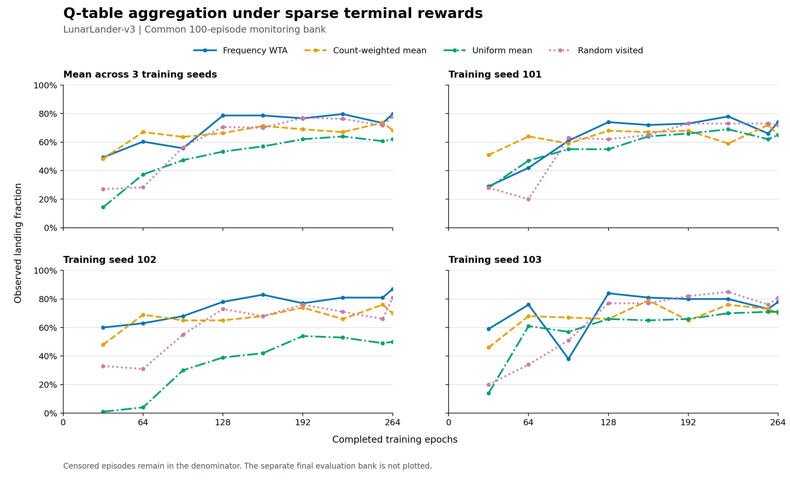

# Sparse Parallel Q-Learning

Jaeyoung Oh

## Overview

This study compares four methods for combining Q-values learned independently
by parallel tabular agents: frequency-based winner-takes-all (WTA), random
selection, count-weighted averaging, and uniform averaging. The task is
LunarLander-v3 with terminal-only land-versus-crash rewards. Under a fixed
264-epoch budget, WTA and random selection reached similar final landing rates,
while WTA achieved a higher learning-curve area in all three paired training
seeds. Both averaging methods had lower mean final performance within this
budget. The results motivate further investigation of how parallel learners
preserve and select value estimates under sparse feedback, including possible
extensions to deep reinforcement learning.

[Results](#results) · [Installation](#installation) · [Run the experiments](#run-the-experiments) · [Method](docs/method.md) · [Related work](#related-work)

## Experimental setting

The learner receives **zero reward on every nonterminal transition**. Native
terminal outcomes provide `+100` for landing and `-100` for failure. This reward
rule applies to both online Q-learning updates and replay. Dense environment
returns are logged for diagnostics but never enter the learning reward.

Each worker interacts with its own environment and learns a local Q-table.
After exceeding 64,000 local steps and finishing its current episode, it
replays its stored transitions in reverse order. Workers then synchronize
their tables and begin the next epoch.

**Episode protocol:** training continues until native termination, including
beyond Gymnasium's 1,000-step truncation signal. There is no timeout penalty.
Evaluation uses the same native-outcome interpretation, with a 100,000-step
guard that records unresolved episodes as censored. These results therefore
describe this explicit protocol, rather than the standard time-limited
LunarLander benchmark. See [the method and protocol](docs/method.md).

## Results

The completed comparison used **16 workers, 264 epochs, and three paired
training seeds per method**. Every run started from an empty Q-table. All
methods used the same local learning procedure and fixed epoch budget.

| Method | Seed 101 | Seed 102 | Seed 103 | Mean final landing rate | Mean learning-curve AUC |
| --- | ---: | ---: | ---: | ---: | ---: |
| Frequency WTA | 80.0% | 81.5% | 76.5% | **79.3%** | **70.4%** |
| Random visited-worker selection | 77.5% | 81.5% | 78.0% | **79.0%** | 61.6% |
| Count-weighted averaging | 72.5% | 67.0% | 63.0% | 67.5% | 66.6% |
| Uniform averaging | 56.0% | 49.0% | 71.0% | 58.7% | 51.6% |

Final landing rates use a separate bank of 200 evaluation episodes per run.
Learning-curve AUC uses the 100-episode monitoring bank at observed epochs
32 through 264, normalized by that interval's length. Censored episodes stay
in the denominator for both metrics. Training seeds are the three replicates;
workers and evaluation episodes are not additional training replicates.



Frequency WTA and random selection reached similar final landing rates. WTA
had a higher monitoring-curve AUC in all three paired seeds, averaging an
**8.7-percentage-point advantage** over random selection. The averaging methods
finished lower within the tested budget. These are descriptive results from
three seeds; AUC differences are not learning-speed multipliers.

The recorded evaluation outcomes, seed banks, source provenance, and analysis
inputs are included in [results/2026-11-12](results/2026-11-12).
[Detailed results](docs/results.md) explain censoring, actual interaction counts,
and the limits of the comparison.

## Interpretation

Frequency WTA and random selection preserve one worker's estimate for each
state/action pair. Averaging combines estimates numerically. WTA chooses the
worker with the most local visits, while random selection chooses uniformly
among workers that visited the pair.

The working hypothesis is that substantial independent learning and reverse
replay develop useful estimates from rare terminal feedback, and that averaging
divergent estimates can dilute those signals. Frequency may help choose which
estimate to retain. Visit counts measure local experience; they do not certify
that an estimate is correct.

These tabular experiments motivate a question for **deep reinforcement
learning**: could preserving locally learned information, and selecting it
using evidence of local experience, help learning in similarly sparse-reward
environments? That transfer remains a research direction. The current study
does not test a deep RL implementation or identify the proposed mechanism
causally.

## Installation

Use **Python 3.9 through 3.12** and **Open MPI** on Apple Silicon macOS or Linux. Windows users
can use the Linux instructions in WSL2. The runtime versions are pinned to the
recorded comparison; see [pyproject.toml](pyproject.toml).

```sh
git clone https://github.com/BlueJayXRStudio/sparse-parallel-q-learning.git
cd sparse-parallel-q-learning
```

On Apple Silicon macOS with Homebrew:

```sh
brew install python@3.11 open-mpi swig
python3.11 -m venv .venv
```

On Ubuntu 22.04 or 24.04:

```sh
sudo apt-get update
sudo apt-get install -y python3-venv python3-dev build-essential swig openmpi-bin libopenmpi-dev
python3 -m venv .venv
```

Then install the project in that environment:

```sh
source .venv/bin/activate
python -m pip install --upgrade pip setuptools wheel swig
python -m pip install --no-build-isolation box2d-py==2.3.5
python -m pip install -e ".[analysis]"
```

SWIG and a C++ compiler are needed to build Box2D. On macOS, install the Xcode
Command Line Tools with `xcode-select --install` if they are not already present.
Building Box2D separately with `--no-build-isolation` makes the installed SWIG
tool available during its build.
The supported launcher uses Open MPI command-line options. See the official
[Gymnasium Box2D setup](https://gymnasium.farama.org/environments/box2d/)
and [mpi4py installation guide](https://mpi4py.readthedocs.io/en/stable/install.html)
for platform-specific dependencies.

## Run the experiments

Inspect the frozen configuration without launching workers:

```sh
spq-compare --dry-run
```

Run one frequency-WTA condition with its original 264-epoch budget:

```sh
spq-compare --execute --condition frequency_wta --seed 101 --study-dir data/wta-101
```

Run the complete four-method, three-seed comparison:

```sh
spq-compare --execute --study-dir data/comparison
```

The launcher starts MPI jobs sequentially. Run it directly, without an outer
`mpirun`. It records the selected runs, configuration, sources, dependency
versions, seed banks, checkpoints, training counts, and evaluation outcomes in
the study directory. Use a new directory for a fresh run.

The reference study took approximately **4 hours 53 minutes** on the original
machine. Runtime depends on hardware and episode duration. Because training
has no episode cap, some epochs can take substantially longer than others.
Sixteen workers are part of the reference protocol; a smaller worker count
would be a separate experimental condition.

Each launch starts a fresh study. An interrupted run remains available for
inspection; use a new output directory to run it again. See
[the experiment guide](docs/experiments.md) for output files and evaluation
commands.

## Reproduce the analysis

Recompute summaries and plots from the included evaluation records:

```sh
spq-analyze results/2026-11-12 --output-dir analysis-output --plots
```

Analyze a newly completed study with the same command:

```sh
spq-analyze data/comparison --output-dir analysis-output/new-study --plots
```

These commands use saved records and do not run training or evaluation.
Large checkpoints and runtime logs are excluded from Git; fresh experiments
generate their own artifacts.

## Related work

The replay phase applies one-step Q-learning updates to stored transitions in
reverse chronological order before synchronization. Its
historical code label is "backward induction"; **reverse-order experience
replay** describes the operation precisely.

Reverse replay has established precedents. **Lin (1992), Section 2.3, p. 299**,
explicitly describes replaying experiences backward in time for credit
propagation. **Sutton and Barto (2018), Chapter 8**, provides the broader
planning background, including backward focusing and prioritized sweeping in
Section 8.4. The latter uses a model and priority queue, which this replay
procedure does not use.

- Long-Ji Lin. *Self-improving reactive agents based on reinforcement learning,
  planning and teaching*. Machine Learning 8, 293-321, 1992.
  [Paper](https://link.springer.com/content/pdf/10.1007/BF00992699.pdf#page=7)
- Richard S. Sutton and Andrew G. Barto. *Reinforcement Learning: An
  Introduction*. Second edition, MIT Press, 2018. Chapter 8.
  [Textbook](https://www.andrew.cmu.edu/course/10-703/textbook/BartoSutton.pdf)

The comparison holds reverse replay fixed across methods and studies how
workers combine their Q-values. It does not claim novelty for replay itself.
The [related-work notes](docs/related_work.md) also distinguish terminal-only
rewards from delayed dense rewards and explain why results from different
LunarLander protocols require careful comparison.

## Limitations and future work

The results apply to the tested state encoding, exploration schedule, replay
procedure, and 64,000-step local threshold. Shorter local-learning intervals
could change the relative performance of averaging and selection. A future
cadence study should match interaction budgets and account for the accompanying
changes in replay frequency and exploration. No cadence sweep has been run.

Independent reproductions are welcome. When reporting one, include the source
revision, platform and dependencies, configuration, training seeds, actual
interaction counts, and native outcomes including censoring.

## Project provenance

The original formulation, implementation, and initial experiments were completed
over three months of independent, full-time research before the subsequent
comparison-study and documentation work. The standalone package preserves that
learning procedure and adds the configuration, evaluation, and analysis tools
needed to reproduce the comparison.

## Citation and license

Citation metadata is provided in [CITATION.cff](CITATION.cff).

Released under the [MIT license](LICENSE). The environment is provided by
Gymnasium, maintained by the Farama Foundation as a continuation of OpenAI Gym.
Installed dependencies retain their respective licenses.
