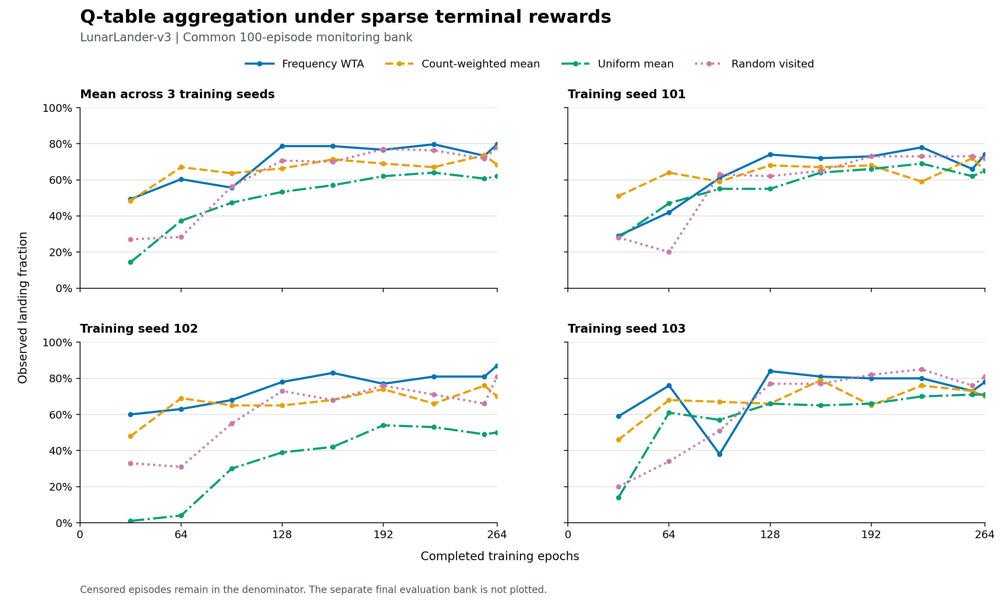

# Results and reproducible analysis

The completed study compares four Q-table aggregation methods on LunarLander-v3
with truly sparse, terminal-only learning rewards. The included records preserve
the measured comparison and its source provenance.

All twelve runs started from empty tables and completed the same fixed budget:
264 epochs, sixteen workers, and a 64,000-step local threshold per worker.
Workers finish their current episode after exceeding that threshold, apply
reverse-order experience replay with one-step Q-learning updates, and then
synchronize. Actual interactions therefore differ across runs. Per-run and
per-checkpoint interaction and replay counts are included in the records.

## Final landing outcomes

Each cell below uses all 200 assigned final-bank episodes. Censored episodes
remain in that denominator. The mean is the arithmetic mean across training
seeds 101, 102, and 103.

| Aggregation | Seed 101 | Seed 102 | Seed 103 | Mean | Censored, by seed |
| --- | ---: | ---: | ---: | ---: | --- |
| Frequency WTA | 160/200 (80.0%) | 163/200 (81.5%) | 153/200 (76.5%) | 79.3% | 0, 0, 1 |
| Random visited worker | 155/200 (77.5%) | 163/200 (81.5%) | 156/200 (78.0%) | 79.0% | 1, 0, 3 |
| Count-weighted mean | 145/200 (72.5%) | 134/200 (67.0%) | 126/200 (63.0%) | 67.5% | 1, 0, 1 |
| Uniform mean | 112/200 (56.0%) | 98/200 (49.0%) | 142/200 (71.0%) | 58.7% | 0, 1, 1 |

These are fixed-budget observations from three training seeds. Workers and
evaluation episodes are not independent training replicates. Censoring bounds
in the JSON outputs represent the range obtained if unresolved episodes
eventually all fail or all land; they are not confidence intervals.

## Learning across the observed window



The common monitoring bank contains 100 episodes at each checkpoint. The plot
connects observations at epochs 32, 64, 96, 128, 160, 192, 224, 256, and 264.
It does not include the separate final bank or invent an epoch-zero observation.

| Aggregation | Mean normalized monitoring AUC, epochs 32–264 |
| --- | ---: |
| Frequency WTA | 70.3621% |
| Count-weighted mean | 66.6322% |
| Random visited worker | 61.6149% |
| Uniform mean | 51.5632% |

AUC is trapezoidal area divided by the 232-epoch observed span. WTA exceeds
random visited-worker selection in all three paired seeds by 5.5690, 13.7414,
and 6.9310 percentage points, averaging 8.7471 points. This is a descriptive
advantage across the learning window, not a universal speed multiplier.

The optional threshold descriptions in `learning_speed.json` were added after
the study. They report observed crossings and later regressions, not exact or
permanent convergence times. For example, the three-seed mean first reaches
75% at epoch 128 for WTA and 192 for random selection, but both fall below 75%
at epoch 256. The training budget was fixed independently of these outcomes.

## Reward, termination, and censoring protocol

Learning receives zero on nonterminal transitions and the environment's native
terminal `+100` or `-100` otherwise. Both online updates and stored replay
transitions use this sparse reward. Environment shaping rewards are retained
only for reporting.

Training and evaluation continue after Gymnasium's time-limit truncation until
native termination. The artificial 1,000-step training penalty is disabled.
Evaluation records an unresolved episode as censored at 100,000 steps without
changing its reward or counting it as a crash. This native-termination protocol
differs from evaluation that ends at Gymnasium's default time limit. Episode
records preserve truncation observations, termination flags, terminal rewards,
and guard status so this distinction remains auditable. Reported raw-return
means include partial returns for censored episodes.

Exploration starts at epsilon 0.03 and decays linearly to zero at epoch 100.
Each worker's environment is seeded on its first reset and then follows its
continuous local RNG stream. Evaluation uses explicit common seed banks,
including a separate final bank. Every condition retains the same local
learning and reverse-replay procedure.

## Recreate the analysis

Install the package as described in the main README. Numerical analysis uses
only the Python standard library. Install the optional plotting dependency with
`python -m pip install -e '.[analysis]'` when using `--plots`.

```sh
spq-analyze results/2026-11-12 --output-dir analysis-output --plots
```

The equivalent module command is:

```sh
python -m sparse_parallel_q.analyze results/2026-11-12 --output-dir analysis-output --plots
```

The command validates file hashes, the completed run matrix, episode identities,
seed assignments, native outcome labels, censoring denominators, and checkpoint
references before rebuilding `summary.json`, `learning_speed.json`, the PNG/SVG
curves, and `provenance.json`. It never runs an environment or unpickles a table.
Floating-point calculations reproduce the original study's final counts, AUCs,
matched-seed contrasts, and descriptive threshold results. Plot bytes may vary
with the Matplotlib version; numerical data are the reproducibility target.

The same command accepts a newly completed study directory:

```sh
spq-analyze data/comparison/MY_STUDY --output-dir analysis-output --plots
```

For native studies, the analyzer also verifies archived source and checkpoint
bytes against their manifests. An explicitly selected completed subset, such
as one condition and seed, is supported and labeled `full_declared_matrix: false`.
Only available matched seeds form paired comparisons. Missing runs without an
explicit archived selection cause an error. Incomplete studies are rejected.
For a single monitoring checkpoint, AUC is recorded as `null` because there is
no measured integration window.

## Included records

The approximately 6 MB input bundle in `results/2026-11-12/` contains:

- `evaluations.jsonl`: all 120 assessments, including 13,200 individual episode
  records, original aggregate counts, and original result/checkpoint hashes.
- `runs.json`: all twelve training summaries and 108 checkpoint counter records.
- `config.json` and `seed_banks/`: the scientific study settings and exact
  evaluation seeds. Display-only settings are omitted from the exported config.
- `study.json`: portable input hashes, relevant dependency versions,
  historical source fingerprints by component, and the recorded scope of
  extraction validation.
- `analysis/`: regenerated summaries and curves, with their input and code hashes.

Historical source files, checkpoint binaries, and runtime logs are not included
in this compact release. Source fingerprints identify historical files but do
not allow their contents to be independently inspected from this bundle.
Portable analysis can audit saved outcomes and their arithmetic, but cannot
rerun historical policies without those checkpoints or independently reconstruct
every training transition. The standalone implementation is in
`sparse_parallel_q/`; the recorded study predates this package.

## Interpretation and future work

The results support investigating whether selecting individual local estimates
preserves useful learning signals that averaging can dilute, and whether visit
frequency improves the choice over random selection. This is a mechanism
hypothesis, not an established causal explanation or a guarantee that selected
Q-values are correct. The comparison holds reverse replay fixed and does not
isolate its effect.

The tested local threshold is 64,000 steps. Cadence sensitivity, additional
training seeds, and transfer of these ideas to deep reinforcement learning are
future work. The present measurements do not establish a universal ranking of
aggregation methods or a result for deep RL.
